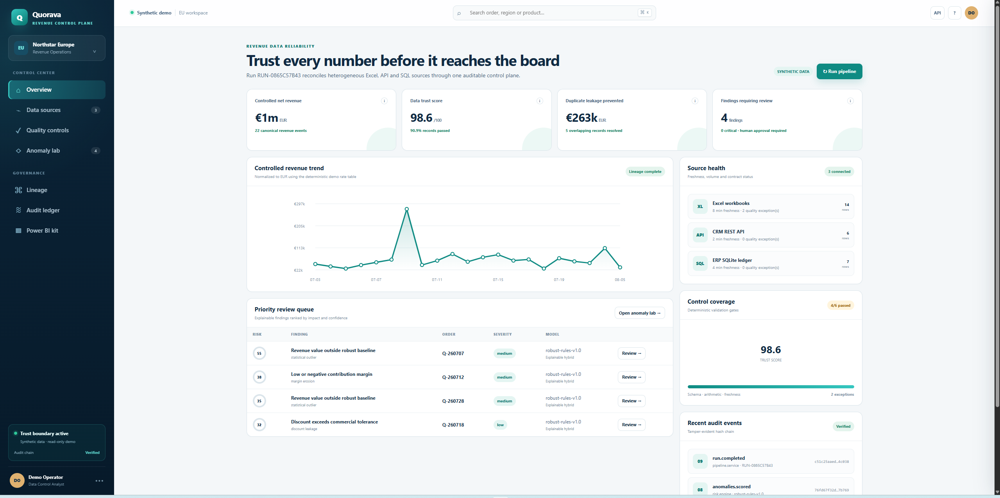
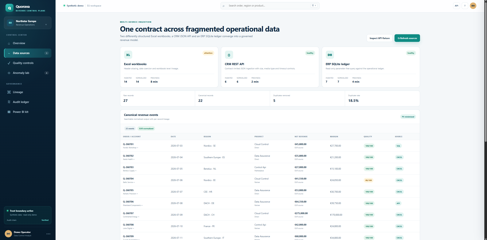
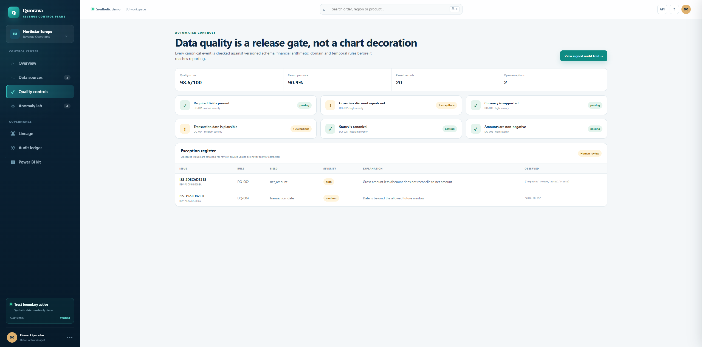
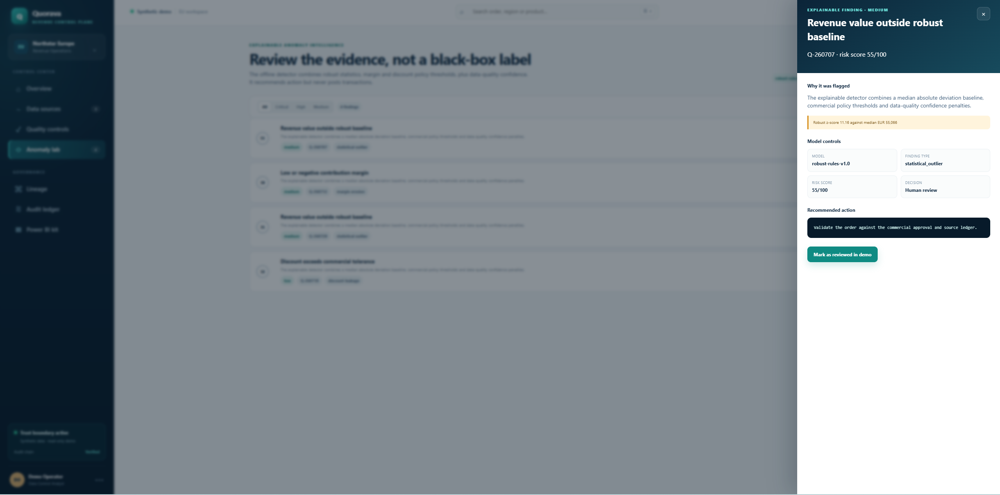
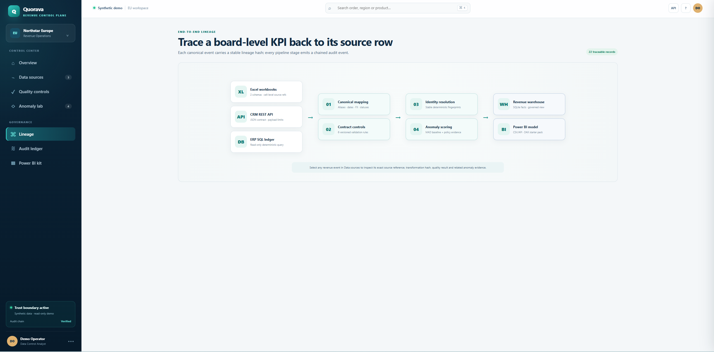
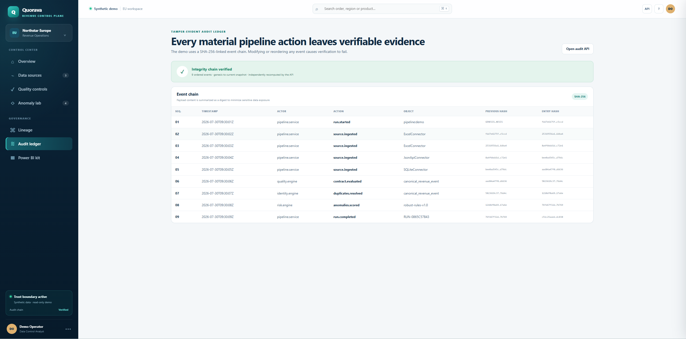
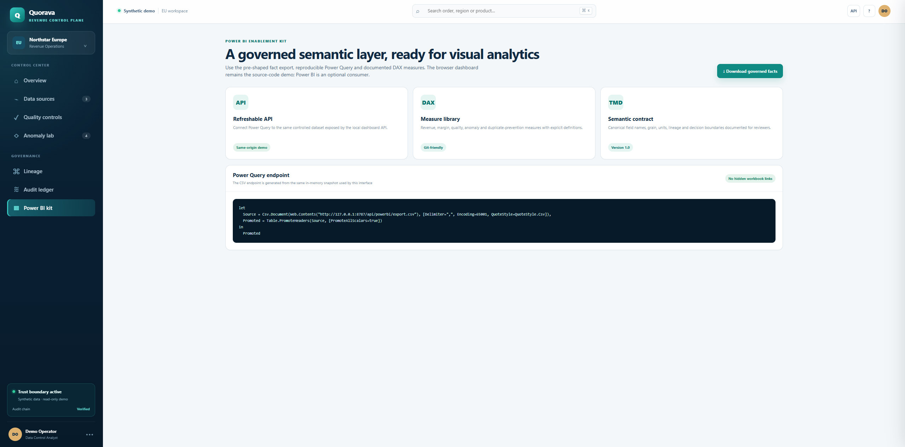
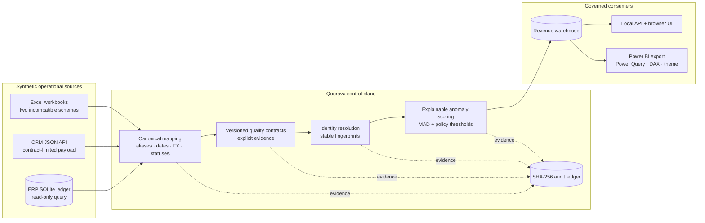

# Quorava Revenue Control Plane

<div align="center">

**Auditable multi-source revenue data reliability and anomaly intelligence**

Quorava reconciles fragmented Excel, API, and SQL revenue data into a controlled analytical layer with deterministic quality gates, explainable anomaly detection, record-level lineage, tamper-evident audit evidence, and a governed Power BI export.

[](https://github.com/cosminchirita/quorava-revenue-control-plane/actions/workflows/ci.yml)
[](https://github.com/cosminchirita/quorava-revenue-control-plane/actions/workflows/codeql.yml)
[](https://www.python.org/)
[](LICENSE)
[](#demo-and-production-boundary)

</div>

> [!IMPORTANT]
> Quorava is a presentation-ready engineering demonstration built exclusively with synthetic data and simulated integrations. It is not a production financial system, does not execute financial transactions, and does not make autonomous financial decisions.



## Table of contents

- [Executive summary](#executive-summary)
- [Why Quorava exists](#why-quorava-exists)
- [What makes this project different](#what-makes-this-project-different)
- [Demonstrated business outcomes](#demonstrated-business-outcomes)
- [Product walkthrough](#product-walkthrough)
- [Architecture](#architecture)
- [End-to-end processing model](#end-to-end-processing-model)
- [Data sources and canonical contract](#data-sources-and-canonical-contract)
- [Data-quality controls](#data-quality-controls)
- [Identity resolution and duplicate prevention](#identity-resolution-and-duplicate-prevention)
- [Explainable anomaly intelligence](#explainable-anomaly-intelligence)
- [Lineage and auditability](#lineage-and-auditability)
- [Power BI enablement](#power-bi-enablement)
- [API reference](#api-reference)
- [Quick start](#quick-start)
- [Verification and testing](#verification-and-testing)
- [Security, privacy, and responsible AI](#security-privacy-and-responsible-ai)
- [Repository structure](#repository-structure)
- [Five-minute demo script](#five-minute-demo-script)
- [Demo and production boundary](#demo-and-production-boundary)
- [Production evolution](#production-evolution)
- [Contributing, security reports, and license](#contributing-security-reports-and-license)

## Executive summary

Finance, revenue operations, and business-intelligence teams rarely receive a single clean dataset. Revenue events arrive through workbooks maintained by different teams, CRM APIs with their own contracts, and ERP databases with separate identifiers and lifecycle rules. Before those numbers reach a board report or Power BI model, the organization must answer four questions:

1. **Are the values structurally and financially valid?**
2. **Has the same business event been counted more than once?**
3. **Can an unusual value be explained and reviewed by a human?**
4. **Can every reported KPI be traced to its original source evidence?**

Quorava answers those questions through a locally runnable control plane. It ingests heterogeneous sources, maps them into a versioned canonical contract, preserves explicit quality exceptions, resolves duplicate identities deterministically, produces explainable risk findings, and records every material processing step in a verifiable SHA-256 event chain.

The browser interface is backed by a real local API and a reproducible analytical snapshot. The dashboard is not a collection of static mock cards.

## Why Quorava exists

Traditional portfolio dashboards often begin after the difficult data work has already been completed. They visualize a clean CSV but do not demonstrate:

- how incompatible source schemas are reconciled;
- how duplicates are detected across systems;
- how questionable values remain visible instead of being silently corrected;
- how an anomaly score can be explained to a financial reviewer;
- how a KPI can be traced back to its source row;
- how an audit trail can detect modification or reordering;
- how a governed dataset can be exposed to Power BI without hidden workbook dependencies.

Quorava makes those engineering and governance decisions visible.

## What makes this project different

- **Real heterogeneous inputs:** two `.xlsx` workbooks with different headers and date formats, a JSON API fixture, and a SQLite operational ledger.
- **Canonical financial contract:** aliases, identifiers, dates, statuses, monetary precision, currencies, and analytical values are normalized predictably.
- **Deterministic reconciliation:** the same input always produces the same canonical records, duplicate register, findings, and audit evidence.
- **Explicit uncertainty:** contract failures generate visible issues; source values are not silently changed to force reconciliation.
- **Explainable anomaly scoring:** findings contain evidence, a model version, a risk score, severity, and a recommended human-review action.
- **Human decision boundary:** the system prioritizes review but never approves, rejects, posts, pays, or accuses.
- **Traceability by design:** source reference, source row, stable record identifier, and lineage hash are retained.
- **Tamper-evident operations:** every material pipeline event is chained to the previous event hash.
- **Power BI-ready semantic layer:** governed CSV, Power Query, DAX measures, and a reusable theme are stored as reviewable text assets.
- **Security-conscious local API:** bounded inputs, read-only SQL access, safe static-file resolution, restrictive browser headers, and role-gated pipeline reruns.
- **Professional repository controls:** automated tests, multi-version CI, CodeQL, Dependabot, issue templates, contribution guidance, and a security policy.

## Demonstrated business outcomes

The bundled deterministic dataset produces the following verifiable result:

| Metric | Result | Why it matters |
| --- | ---: | --- |
| Raw source records | 27 | Shows the complete multi-source ingestion volume |
| Canonical revenue events | 22 | Represents the controlled reporting grain |
| Duplicate candidates removed | 5 | Prevents repeated revenue from reaching KPI calculations |
| Duplicate rate | 18.5% | Quantifies the exposure identified by identity resolution |
| Data trust score | 98.6 / 100 | Summarizes the outcome of versioned validation controls |
| Record pass rate | 90.9% | Keeps the distinction between aggregate score and record-level exceptions |
| Review findings | 4 | Routes unusual records to an evidence-backed review queue |
| Reconciled net revenue | EUR 1,420,172.00 | Confirms that API, browser, warehouse, and Power BI export agree |
| Canonical records with lineage | 22 / 22 | Provides source-level traceability for every reporting event |
| Audit-chain verification | Valid | Detects changes to event order or content |

These values are synthetic and reproducible. They are not market, customer, or accounting data.

## Product walkthrough

### 1. Executive revenue control

The overview combines controlled revenue, trust score, duplicate leakage prevented, findings requiring review, source freshness, validation coverage, revenue trend, and recent audit activity.


### 2. Multi-source ingestion and reconciliation

The source workspace exposes the Excel, CRM API, and ERP SQL connectors, along with ingested volume, freshness, normalization status, duplicate prevention, and the canonical revenue-event table.



### 3. Automated data-quality controls

Every canonical event is evaluated against versioned structural, financial, domain, and temporal rules. Exceptions remain visible with their rule identifier, affected field, severity, explanation, and observed value.



### 4. Explainable anomaly review

The anomaly workspace does not expose only a label. Reviewers see why the record was flagged, the supporting evidence, model version, finding type, risk score, decision boundary, and recommended action.



### 5. End-to-end lineage

The lineage view explains how Excel, API, and SQL inputs pass through canonical mapping, contract controls, identity resolution, and anomaly scoring before reaching the analytical warehouse and Power BI model.



### 6. Tamper-evident audit ledger

Each material action records its sequence, actor, action, object reference, previous hash, and current entry hash. Verification is recomputed independently by the API.



### 7. Power BI enablement

The governed Power BI interface provides a refreshable CSV endpoint, reproducible Power Query, documented DAX measures, and a semantic contract without hidden workbook dependencies.



## Architecture



### Architectural properties

- local-first and independently runnable;
- deterministic demo clock, source ordering, exchange rates, rules, and model version;
- idempotent record fingerprints and stable identifiers;
- versioned data contract and quality rules;
- read-only operational SQL ingestion;
- explicit transformation and review evidence;
- one canonical snapshot shared by API, UI, warehouse verification, and Power BI export;
- minimal runtime dependency surface.

Read the detailed design in [docs/ARCHITECTURE.md](docs/ARCHITECTURE.md).

## End-to-end processing model

### Stage 1 — Ingest

Each connector emits raw rows with:

- source type;
- source reference;
- source row;
- original field names and values;
- ingestion metadata.

The API connector allows only `http` and `https`, requires JSON media types, applies a timeout, and limits response size. The SQLite connector uses a fixed read-only query.

### Stage 2 — Normalize

Source aliases are mapped to the canonical contract. The pipeline standardizes:

- identifiers as strings;
- dates as ISO `YYYY-MM-DD`;
- lifecycle statuses;
- monetary precision;
- source currency;
- analytical EUR values using a versioned synthetic FX table.

Original financial values and source metadata remain available for evidence.

### Stage 3 — Validate

Six versioned rules evaluate the canonical records. Failures produce separate quality issues containing:

- issue identifier;
- rule identifier;
- field;
- severity;
- explanation;
- observed value;
- related record identifier.

The pipeline does not mutate a source amount merely to make validation pass.

### Stage 4 — Resolve identity

A stable fingerprint groups candidate representations of the same revenue event. Candidate precedence is deterministic:

1. fewer data-quality issues;
2. trusted-source order: SQL, API, then Excel;
3. stable source reference ordering.

The selected record becomes canonical, while removed candidates remain visible in the duplicate register.

### Stage 5 — Score anomalies

The detector combines:

- median absolute deviation for robust revenue baselines;
- commercial discount thresholds;
- contribution-margin thresholds;
- data-quality confidence penalties.

The output includes a risk score, severity, evidence list, model version, and recommended review action.

### Stage 6 — Materialize and reconcile

The pipeline writes:

- an immutable-style JSON snapshot;
- a queryable SQLite analytical model;
- a governed Power BI-ready CSV;
- audit evidence for every material action.

The verification script confirms that API, canonical snapshot, warehouse, and Power BI export reconcile.

## Data sources and canonical contract

### Bundled sources

| Source | Location | Purpose |
| --- | --- | --- |
| EMEA sales workbook | `data/excel/emea_sales_july.xlsx` | Direct-sales schema with its own headings and date conventions |
| Partner orders workbook | `data/excel/partner_orders_july.xlsx` | Partner-channel schema intentionally different from the first workbook |
| CRM JSON snapshot | `data/api/crm_snapshot.json` | Deterministic fixture exposed through the local API connector |
| ERP operational ledger | `data/sql/operations.db` | Synthetic SQLite source queried through a read-only adapter |

### Canonical grain

The canonical grain is:

> **One resolved revenue event per order identifier, ISO transaction date, and normalized net amount.**

Canonical records retain:

- order and account identifiers;
- minimized customer display label;
- transaction date;
- region and country;
- product family and channel;
- gross, discount, net, cost, and margin values;
- original currency and normalized EUR values;
- source type, reference, and row;
- quality score;
- lineage hash;
- model and contract metadata.

See [docs/DATA_CONTRACTS.md](docs/DATA_CONTRACTS.md) and the versioned files under [`config/`](config/).

## Data-quality controls

Quorava treats data quality as a release gate rather than a decorative dashboard metric.

The included rule set covers:

- mandatory identifiers and required fields;
- valid ISO dates;
- recognized currencies, regions, statuses, and business domains;
- arithmetic consistency between gross, discount, net, cost, and margin;
- allowed value ranges;
- temporal validity and freshness.

### Quality semantics

`score`, `pass rate`, and `exception count` are intentionally separate:

- **Trust score** summarizes weighted quality outcomes.
- **Record pass rate** measures how many records passed all applicable controls.
- **Exception count** preserves each actionable rule violation.

This avoids presenting one aggregate number as if it described every record equally.

## Identity resolution and duplicate prevention

Duplicate detection is deterministic and audit-friendly. It does not depend on an opaque similarity model.

The implementation:

1. creates a normalized business fingerprint;
2. groups records with the same business identity;
3. compares data-quality evidence;
4. applies the trusted-source precedence;
5. selects one canonical winner;
6. records discarded candidates and their reason.

The bundled scenario removes five overlapping records before KPI calculation, preventing duplicate revenue leakage from entering the reporting layer.

## Explainable anomaly intelligence

### Model card

| Attribute | Value |
| --- | --- |
| Model version | `robust-rules-v1.0` |
| Purpose | Prioritize unusual revenue events for expert review |
| Inputs | Normalized revenue, margin, discount, and quality confidence |
| Method | Median absolute deviation plus transparent policy thresholds |
| Output | Risk score, severity, evidence, and recommended action |
| Final decision | Human review |
| Prohibited use | Autonomous approval, rejection, posting, payment, customer action, or fraud accusation |

### Why the model is explainable

Every finding includes:

- the triggering condition;
- comparison baseline or policy threshold;
- evidence values;
- risk score;
- severity;
- finding type;
- model version;
- recommended review step.

The detector is deterministic and inspectable. The project does not claim that the small synthetic dataset represents a production business distribution.

Read the complete limitations and production requirements in [docs/RESPONSIBLE_AI.md](docs/RESPONSIBLE_AI.md).

## Lineage and auditability

### Record-level lineage

Each canonical event stores enough metadata to trace a reported value to:

- source connector;
- source file, API object, or database row reference;
- source row;
- transformation path;
- quality evidence;
- related anomaly evidence;
- stable lineage hash.

### Hash-chained audit ledger

For every material event, Quorava computes an entry hash from:

- sequence number;
- timestamp;
- actor;
- action;
- object reference;
- payload digest;
- previous event hash.

Changing an event or reordering the chain changes the expected hashes and causes verification to fail. Audit entries store payload digests instead of unnecessarily duplicating full financial records.

## Power BI enablement

Quorava provides text-based, reviewable Power BI assets instead of committing an opaque `.pbix` binary.

| Asset | Location | Purpose |
| --- | --- | --- |
| Governed fact endpoint | `/api/powerbi/export.csv` | Controlled canonical fact export |
| Power Query | `powerbi/power-query.m` | Reproducible source connection |
| DAX measures | `powerbi/measures.dax` | Revenue, margin, quality, anomaly, and duplicate-prevention measures |
| Theme | `powerbi/theme.json` | Reusable Quorava visual identity |
| Guide | `docs/POWER_BI.md` | Setup and modeling instructions |

### Connect Power BI Desktop

1. Start Quorava locally.
2. Open Power BI Desktop.
3. Select **Get Data → Web**.
4. Use:

   ```text
   http://127.0.0.1:8787/api/powerbi/export.csv
   ```

5. Alternatively, create a blank query and paste the contents of `powerbi/power-query.m`.
6. Apply `powerbi/theme.json`.
7. Add the documented measures from `powerbi/measures.dax`.

The local server must remain active while Power BI refreshes the endpoint.

## API reference

Base URL:

```text
http://127.0.0.1:8787
```

| Method | Endpoint | Purpose |
| --- | --- | --- |
| `GET` | `/api/health` | Service and analytical-snapshot health |
| `GET` | `/api/overview` | Executive KPIs, source health, findings, and recent audit events |
| `GET` | `/api/records` | Searchable canonical revenue events |
| `GET` | `/api/records/{record_id}` | Financial, lineage, quality, and risk evidence for one event |
| `GET` | `/api/anomalies` | Explainable anomaly register |
| `GET` | `/api/quality` | Rule definitions, summary, and visible exceptions |
| `GET` | `/api/lineage` | Source-to-target topology and traceable-record metadata |
| `GET` | `/api/audit` | Ordered hash chain and independent verification result |
| `GET` | `/api/powerbi/export.csv` | Governed Power BI-ready fact export |
| `GET` | `/api/source/crm` | Synthetic CRM fixture served through the demo API |
| `POST` | `/api/runs` | Re-run the synthetic pipeline with the `analyst` demo role |

### Example health request

```bash
curl http://127.0.0.1:8787/api/health
```

### Example record search

```bash
curl "http://127.0.0.1:8787/api/records?search=Q-260701"
```

### Example pipeline rerun

```bash
curl -X POST \
  -H "X-Demo-Role: analyst" \
  -H "Content-Type: application/json" \
  -d "{}" \
  http://127.0.0.1:8787/api/runs
```

The role header is a deliberate demo control, not production authentication.

## Quick start

### Prerequisites

- Python 3.11 or newer;
- Git for repository workflows;
- a modern browser;
- optional: Docker Desktop;
- optional: Power BI Desktop for the semantic-layer walkthrough.

No Node.js runtime, cloud account, API key, or production credential is required.

### Windows — one-command start

```powershell
git clone https://github.com/cosminchirita/quorava-revenue-control-plane.git
cd quorava-revenue-control-plane
Set-ExecutionPolicy -Scope Process Bypass
.\run-demo.ps1
```

Open [http://127.0.0.1:8787](http://127.0.0.1:8787).

The script:

1. creates `.venv` if required;
2. installs the project in editable mode;
3. bootstraps the synthetic SQL source;
4. runs the deterministic pipeline;
5. starts the local server.

### macOS or Linux — one-command start

```bash
git clone https://github.com/cosminchirita/quorava-revenue-control-plane.git
cd quorava-revenue-control-plane
chmod +x run-demo.sh
./run-demo.sh
```

### Manual setup

```bash
python -m venv .venv

# Windows
.venv\Scripts\activate

# macOS / Linux
source .venv/bin/activate

python -m pip install --disable-pip-version-check -e .
python scripts/bootstrap_demo.py
python -m quorava serve --host 127.0.0.1 --port 8787
```

### Docker

```bash
docker compose up --build
```

Open [http://127.0.0.1:8787](http://127.0.0.1:8787).

### Stop the server

Press `Ctrl+C` in the terminal that is running Quorava.

## Verification and testing

Run the complete local quality gate:

```bash
python scripts/check.py
```

Expected result:

```text
Ran 15 tests
OK
All Quorava checks passed.
```

### Verification coverage

The test and verification suite covers:

- Python compilation;
- Excel, JSON API, and SQLite ingestion;
- canonical mapping and date normalization;
- deterministic FX conversion;
- arithmetic and domain quality rules;
- explicit exception evidence;
- identity resolution and source precedence;
- duplicate removal;
- revenue and margin reconciliation;
- anomaly evidence and explanation;
- record-level lineage;
- audit-chain verification;
- API health and security headers;
- path-traversal rejection;
- role-gated pipeline reruns;
- canonical record detail;
- Power BI export reconciliation;
- frontend navigation and demo-boundary contracts;
- Content Security Policy-compatible frontend assets.

### Continuous integration

GitHub Actions runs the quality gate on:

- Python 3.11;
- Python 3.12;
- Python 3.13.

CodeQL analyzes Python changes on pushes, pull requests, and a weekly schedule. Dependabot monitors Python and GitHub Actions dependencies monthly.

## Security, privacy, and responsible AI

### Included demo controls

- local-only `127.0.0.1` binding by default;
- restrictive Content Security Policy;
- frame denial to reduce clickjacking exposure;
- no-referrer policy;
- no permissive cross-origin headers;
- fixed read-only SQL query;
- HTTP scheme allowlist;
- JSON media-type enforcement;
- timeout and payload-size controls;
- bounded API searches and identifiers;
- static-path traversal protection;
- role check for pipeline reruns;
- minimized customer display labels;
- payload digests in the audit ledger;
- synthetic data classification;
- no runtime secrets.

### Data classification

All bundled data is classified:

```text
SYNTHETIC / PUBLIC DEMO
```

Do not replace it with:

- real invoices;
- customer exports;
- credentials or API keys;
- bank or payment information;
- personal data;
- confidential business information.

### Threat-model boundary

The primary demo risks are malicious local input files, oversized API responses, path traversal, browser injection, unauthorized reruns, and accidental replacement of synthetic fixtures with real financial data.

Production use additionally requires organizational identity, role-based authorization, malware scanning, rate limiting, encryption, secrets management, key rotation, immutable retention, centralized observability, incident response, backup, disaster recovery, and regulatory review.

Read:

- [Security and privacy](docs/SECURITY_PRIVACY.md)
- [Responsible AI](docs/RESPONSIBLE_AI.md)
- [Security reporting policy](SECURITY.md)

## Repository structure

```text
.
├── .github/
│   ├── ISSUE_TEMPLATE/       Structured issue intake
│   ├── workflows/            Quality gate and CodeQL
│   └── dependabot.yml        Dependency update policy
├── config/
│   ├── data_contract.json    Canonical schema and contract version
│   ├── exchange_rates.json   Fixed synthetic FX rates
│   ├── field_mappings.json   Source-to-canonical aliases
│   └── quality_rules.json    Versioned validation rules
├── data/
│   ├── api/                  Synthetic CRM fixture
│   ├── excel/                Heterogeneous source workbooks
│   ├── sql/                  Synthetic ERP SQLite ledger
│   └── warehouse/            Generated local analytical outputs
├── docs/
│   ├── images/               Product screenshots
│   ├── ARCHITECTURE.md       Design and production evolution
│   ├── DATA_CONTRACTS.md     Canonical grain and lineage semantics
│   ├── DEMO_SCRIPT.md        Presentation flow
│   ├── POWER_BI.md           Power BI instructions
│   ├── RESPONSIBLE_AI.md     Model card and limitations
│   └── SECURITY_PRIVACY.md   Threat model and controls
├── powerbi/
│   ├── measures.dax          Reviewable semantic measures
│   ├── power-query.m         Reproducible source query
│   └── theme.json            Quorava theme
├── scripts/
│   ├── bootstrap_demo.py     Synthetic source preparation
│   ├── check.py              Complete local quality gate
│   ├── serve_demo.py         Development server entry point
│   └── verify_demo.py        Cross-output reconciliation
├── src/quorava/
│   ├── connectors/           Excel, API, and SQL adapters
│   ├── anomaly.py            Explainable detector
│   ├── api_server.py         Local API and frontend server
│   ├── audit.py              Hash-chain implementation
│   ├── pipeline.py           Orchestration and reconciliation
│   ├── quality.py            Versioned quality evaluation
│   └── storage.py            Snapshot and warehouse materialization
├── tests/                    Unit, integration, security, and UI-contract tests
├── web/                      Responsive browser application
├── Dockerfile
├── docker-compose.yml
├── pyproject.toml
├── run-demo.ps1
└── run-demo.sh
```

## Five-minute demo script

### Minute 1 — Business problem and overview

Open **Overview** and explain that the KPI layer is calculated only after heterogeneous data has passed through reconciliation controls. Highlight:

- controlled net revenue;
- data trust score;
- duplicate leakage prevented;
- findings requiring review;
- source freshness.

### Minute 2 — Multi-source reconciliation

Open **Data sources** and show:

- Excel, API, and SQL connectors;
- raw versus canonical volume;
- removed duplicates;
- normalized EUR values;
- searchable canonical records.

Search for `Q-260701`, open the record, and show its source reference, quality score, and lineage hash.

### Minute 3 — Quality and anomaly evidence

Open **Quality controls** to demonstrate visible rule exceptions.

Then open **Anomaly lab**, select a finding, and explain:

- evidence;
- robust baseline;
- risk score;
- model version;
- human-review decision boundary.

### Minute 4 — Lineage and auditability

Open **Lineage** to explain the source-to-KPI path.

Open **Audit ledger** and point out:

- previous hash;
- entry hash;
- independently verified chain;
- explicit actors and actions.

### Minute 5 — Power BI and reproducibility

Open **Power BI kit**, download the governed CSV, and show the version-controlled Power Query, DAX, and theme assets.

Finish with:

```bash
python scripts/check.py
```

This demonstrates that the business narrative is supported by executable verification.

## Demo and production boundary

### The repository demonstrates

- multi-source data engineering;
- canonical financial modeling;
- automated data-quality controls;
- deterministic identity resolution;
- explainable anomaly prioritization;
- auditability and lineage;
- secure local API design;
- Power BI enablement;
- CI and repository governance.

### The repository does not provide

- production authentication or authorization;
- live ERP, CRM, banking, or payment connectivity;
- production secrets management;
- autonomous financial decisions;
- payment initiation;
- journal posting;
- fraud determination;
- enterprise retention or legal hold;
- production monitoring or disaster recovery.

The distinction is intentional and documented to prevent a portfolio demonstration from being misrepresented as a production financial platform.

## Production evolution

A production implementation would replace the local components with:

- private-network source integrations;
- workload identity and a centralized secrets manager;
- durable orchestration and retry policies;
- encrypted object storage;
- a managed analytical warehouse;
- organization-level authentication and RBAC;
- immutable audit retention;
- centralized logs, metrics, traces, and alerting;
- data-classification and retention enforcement;
- model calibration, back-testing, drift monitoring, and reviewer feedback;
- tested backup, recovery, and incident-response procedures.

The canonical contract, deterministic identity logic, quality evidence, model card, and audit semantics provide a foundation for that evolution.

## Contributing, security reports, and license

- Read [CONTRIBUTING.md](CONTRIBUTING.md) before proposing changes.
- Follow [CODE_OF_CONDUCT.md](CODE_OF_CONDUCT.md).
- Report vulnerabilities according to [SECURITY.md](SECURITY.md), not through a public issue.
- Review significant changes through pull requests with passing CI.

This project is available under the [MIT License](LICENSE).

---

<div align="center">

**Quorava Revenue Control Plane**

Built as a portfolio-grade demonstration of trustworthy revenue data engineering, explainable analytics, and auditable financial-control design.

</div>
