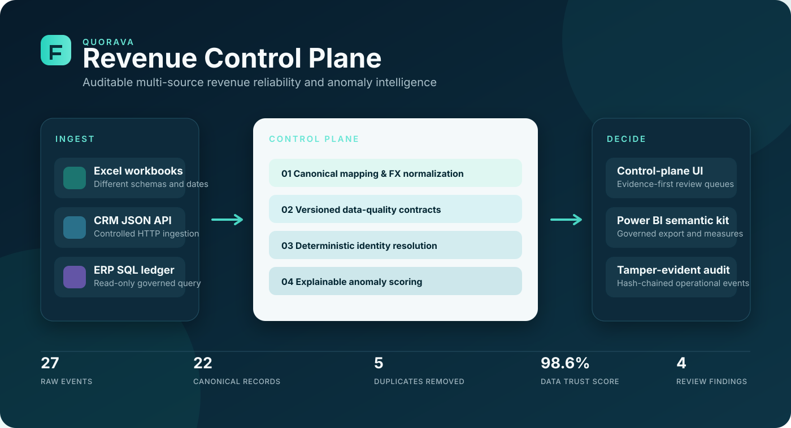
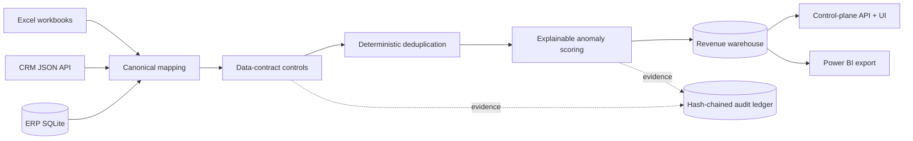

# Quorava Revenue Control Plane

**Auditable multi-source revenue data reliability and anomaly intelligence.**

Quorava is a presentation-ready engineering demo that turns fragmented Excel workbooks, a JSON API and an operational SQL ledger into one controlled revenue dataset. It normalizes incompatible schemas, removes cross-source duplicates, applies versioned financial data-quality rules, calculates decision-grade KPIs, explains anomalies and records every material step in a tamper-evident audit chain.

> **Demo boundary:** this repository uses synthetic organizations and transactions. It does not connect to production systems, move money, approve journal entries or make autonomous financial decisions.



## Why this is different

Most portfolio dashboards begin with already-clean data. Quorava makes the difficult work visible:

- two real `.xlsx` inputs with intentionally different headers and date formats;
- an HTTP JSON connector with media-type, timeout and payload-size controls;
- a read-only SQLite connector and a governed analytical view;
- canonical field mapping, currency normalization and deterministic identity resolution;
- six versioned data-contract checks with visible exceptions;
- explainable anomaly scoring based on robust statistics and policy thresholds;
- per-record lineage hashes and a verifiable SHA-256 event chain;
- a Power BI enablement kit with governed CSV, Power Query, DAX and theme assets;
- a responsive browser UI backed by an actual local API, not static mock cards.

## Product surfaces

| Surface | What it demonstrates |
| --- | --- |
| Overview | Controlled revenue, trust score, duplicate leakage, review queue and source health |
| Data sources | Excel/API/SQL freshness, normalization and canonical records |
| Quality controls | Rule coverage, pass rate and exception evidence |
| Anomaly lab | Risk-ranked, human-reviewable findings with model evidence |
| Lineage | Source-to-KPI transformation path and record-level hashes |
| Audit ledger | Ordered, tamper-evident operational events |
| Power BI kit | Governed export endpoint and reusable semantic-model assets |

## Architecture



The complete design, trust boundaries and production evolution path are documented in [Architecture](docs/ARCHITECTURE.md).

## Quick start

Prerequisites: Python 3.11+.

### Windows

```powershell
.\run-demo.ps1
```

### macOS / Linux

```bash
chmod +x run-demo.sh
./run-demo.sh
```

Open [http://127.0.0.1:8787](http://127.0.0.1:8787). The bootstrap process creates the synthetic SQL source, runs all controls and materializes the local analytical snapshot before the server starts.

### Manual commands

```bash
python -m venv .venv
# Windows: .venv\Scripts\activate
# macOS/Linux: source .venv/bin/activate
python -m pip install -e .
python scripts/bootstrap_demo.py
python -m quorava serve
```

## Verification

Run the same quality gate used by CI:

```bash
python scripts/check.py
```

It verifies Python compilation, unit/integration/frontend-contract tests, deterministic deduplication, FX normalization, data-quality evidence, API security headers, path-traversal rejection, Power BI export reconciliation and audit-chain integrity.

## API

| Method | Endpoint | Purpose |
| --- | --- | --- |
| `GET` | `/api/health` | Service and snapshot health |
| `GET` | `/api/overview` | Executive KPIs and recent findings |
| `GET` | `/api/records` | Filterable canonical revenue events |
| `GET` | `/api/records/{id}` | Record, lineage, quality and risk evidence |
| `GET` | `/api/quality` | Rule definitions and exceptions |
| `GET` | `/api/anomalies` | Explainable anomaly register |
| `GET` | `/api/lineage` | Source-to-target topology |
| `GET` | `/api/audit` | Hash chain plus verification result |
| `GET` | `/api/powerbi/export.csv` | Governed Power BI-ready fact export |
| `POST` | `/api/runs` | Rerun the synthetic pipeline (`analyst` demo role) |

## Repository map

```text
config/                 Versioned contracts, mappings, rules and demo FX rates
data/excel/             Heterogeneous Excel source workbooks
data/api/               Deterministic CRM API fixture
data/sql/               Synthetic operational SQLite ledger
docs/                   Architecture, security, data and demo documentation
powerbi/                Power Query, DAX and theme starter kit
src/quorava/            Connectors, pipeline, quality, anomaly, audit and API
tests/                  Unit, integration, security and UI-contract tests
web/                    Responsive control-plane frontend
```

## Security, privacy and responsible AI

- The server binds to `127.0.0.1` by default.
- Security headers include a restrictive CSP, clickjacking protection and a no-referrer policy.
- SQL ingestion uses a fixed read-only query; HTTP input is scheme, type, timeout and size constrained.
- Customer display labels are minimized, and audit events store payload digests rather than full rows.
- Anomaly evidence is explainable and always routes to human review.
- No secrets or production credentials are required.

See [Security & Privacy](docs/SECURITY_PRIVACY.md), [Responsible AI](docs/RESPONSIBLE_AI.md) and [SECURITY.md](SECURITY.md).

## Power BI

The repository intentionally uses text-based, reviewable Power BI assets instead of committing an opaque `.pbix` binary. Follow [the Power BI guide](docs/POWER_BI.md) to connect the local export and apply the included measures and theme.

## License

MIT. See [LICENSE](LICENSE). The product name is used only as the identity of this portfolio demonstration.
